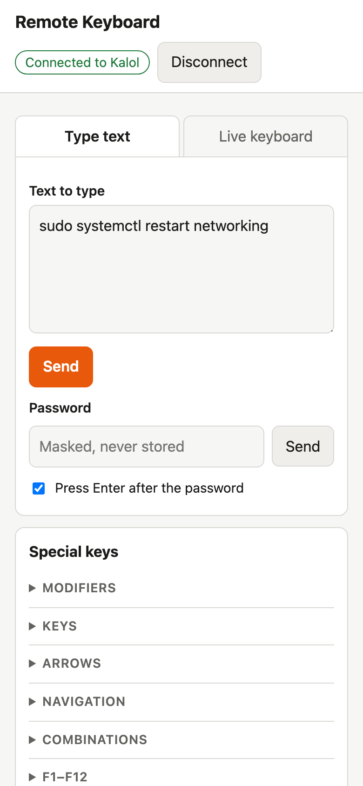
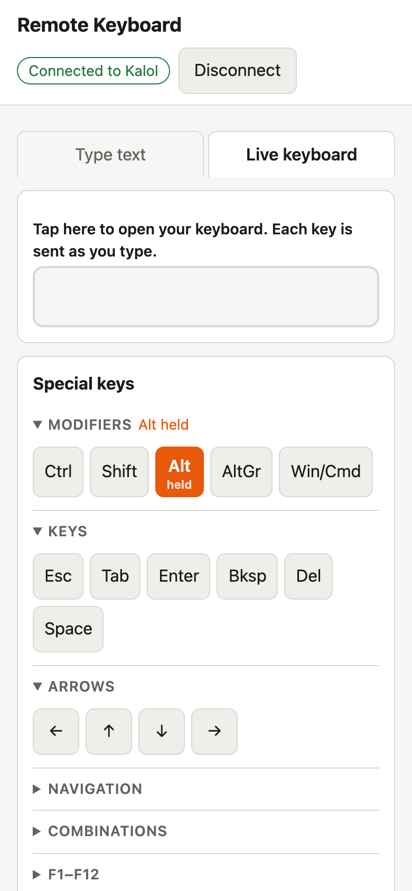

# Flipper Remote Keyboard

Keyboard input for servers without a keyboard, sent from a phone.

A [Flipper Zero](https://flipperzero.one) plugged into the server's USB port acts
as a USB keyboard. A web page on a phone connects to the Flipper over Bluetooth
LE, and keystrokes entered on the phone are typed on the server: console logins,
boot menu choices, disk-encryption passphrases, BIOS settings. The operator
works at the server and reads the result on its screen.

  <picture>
    <source media="(prefers-color-scheme: dark)" srcset="docs/images/web-type-text-dark.png">
    
  </picture>
  &nbsp;&nbsp;
  <picture>
    <source media="(prefers-color-scheme: dark)" srcset="docs/images/web-live-keys-dark.png">
    
  </picture>

## How it works

1. The web page converts input into key presses and sends them to the Flipper
   over Bluetooth LE.
2. The Remote Keyboard app replays them on the Flipper's USB port. The server
   sees a standard USB keyboard; no software or drivers are needed on it.
3. Data flows one way only. Feedback comes from the server's screen.

## Features

- **Type text:** a command or text block is sent in one go. A masked password
  field can append Enter, e.g. for a disk-unlock prompt.
- **Live keyboard:** each key is sent as it is typed, from a phone keyboard or
  from a laptop keyboard including arrows, F-keys and shortcuts.
- **Special keys:** Esc, Tab, arrows, F1–F12, Ctrl+Alt+Del and more. Modifiers
  apply to the next key or stay held, e.g. Alt held while Tab switches windows.
- **Pairing with a PIN:** shown on the Flipper on first connection; the link is
  encrypted and only paired devices can type.
- **No installation on the phone:** a web page that can be added to the home
  screen and works offline after the first visit.
- **Pre-boot use:** the Flipper presents a boot-protocol keyboard, intended for
  BIOS/UEFI setup and boot menus.

## Installation and usage

Requirements: a Flipper Zero on the latest official firmware, and **Chrome** on
Android, **[Bluefy](https://apps.apple.com/app/bluefy-web-ble-browser/id1492822055)**
on iPhone or iPad, or **Chrome / Edge** on a computer. Safari and Firefox do not
support Web Bluetooth.

1. Download `remote_keyboard.fap` from
   [Releases](https://github.com/jaansusi/flipper-bt-keyboard/releases) and copy it
   to the Flipper's SD card at `apps/USB/` (e.g. with qFlipper).
2. Plug the Flipper into the server and start **Apps → USB → Remote Keyboard**.
3. Open **https://jaansusi.github.io/flipper-bt-keyboard/** on the phone, tap
   **Connect** and select the Flipper. On first connection, enter the PIN shown
   on the Flipper.

## Documentation

Architecture, protocol, building, testing and releasing: [docs/](docs/README.md).

## License

[MIT](LICENSE)
